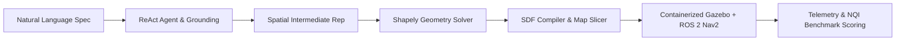

<div align="center">


### Natural Language to Executable Robot Simulation with Dynamic Stress Testing

[](LICENSE)
[](https://www.python.org/)
[](https://docs.ros.org/en/humble/)
[](https://gazebosim.org/)
[](https://github.com/astral-sh/ruff)
[](https://pointblank-club.github.io/Lang2Sim/)
[](https://github.com/Point-Blank-Club/Lang2Sim/tree/staging)

</div>

---

## Overview

**Lang2Sim** is an open-source autonomous robotics simulation copilot developed for robotics researchers and engineers who benchmark Simultaneous Localization and Mapping (SLAM) and autonomous navigation algorithms in **Gazebo**.

Bridging qualitative mission descriptions to deterministic physics simulations traditionally requires weeks of manual URDF/SDF modeling, costmap tuning, and ROS 2 transform configuration. Lang2Sim automates this end-to-end pipeline:

1. **Agentic Reasoning:** Deconstructs fuzzy natural language goals via a ReAct loop powered by NVIDIA Nemotron into structured, collision-free spatial specifications.
2. **Deterministic World Synthesis:** Solves 2D non-overlapping placement constraints using Shapely and compiles verified Spatial Intermediate Representation (SIR) schemas into Gazebo Harmonic `.sdf` worlds.
3. **Zero-SLAM Costmap Slicing:** Analytically slices 3D geometries into 2D `.yaml` / `.pgm` occupancy grids without requiring manual teleoperation mapping runs.
4. **Containerized Execution:** Launches native desktop Gazebo Harmonic and RViz2 graphical interfaces with hardware-accelerated X11/WSLg display pass-through.
5. **Closed-Loop Telemetry:** Subscribes to live `/odom` and `/scan` ROS 2 topics, evaluates trajectory deviations ($ATE$, $RPE$), and scores runs via the Navigation Quality Index ($NQI$).

---

## Architecture Pipeline



---

## Quickstart

### Prerequisites
- Linux (Ubuntu 20.04/22.04/24.04), Windows 10/11 with WSL2, or macOS.
- Python 3.10 or newer.
- Docker & Docker Compose (optional for Dockerless replay mode).

### 1. Installation
Clone the repository and install in editable mode:

```bash
git clone https://github.com/Point-Blank-Club/Lang2Sim.git
cd Lang2Sim

# Create and activate virtual environment
python3 -m venv .venv
source .venv/bin/activate

# Install development & simulation dependencies
pip install -e ".[sim,dev]"
```

### 2. Launch the TUI Copilot
Launch the interactive Textual terminal dashboard:

```bash
lang2sim
```

### 3. Run a Simulation Run (Docker-backed)
Execute a headless or desktop simulation against a catalog fixture:

```bash
python scripts/run_sim.py --fixture small_warehouse --mission
```

### 4. Headless Replay & Benchmark (No Docker Needed)
If running on low-spec hardware or reviewing prior benchmark runs:

```bash
# Replay telemetry trajectory in terminal
python -m lang2sim.telemetry.replay catalog/demo_runs/empty_room_benchmark --loop

# Score run quality (calculates NQI metrics)
python -m lang2sim.telemetry.benchmark catalog/demo_runs/empty_room_benchmark
```

---

## Interactive TUI Slash Commands

Within the `lang2sim` full-screen interface, interact via the command prompt:

| Command | Purpose |
| :--- | :--- |
| `/mission <prompt>` | Synthesize an executable Gazebo world from natural language description. |
| `/stress <type>` | Apply dynamic physics perturbations (obstacle drops, friction changes). |
| `/benchmark` | Compute trajectory evaluation metrics and Navigation Quality Index ($NQI$). |
| `/dashboard` | Launch real-time telemetry dashboard on `http://localhost:9090`. |
| `/replay <path>` | Play back pre-recorded or crash-recovered robot run frames. |
| `/report` | Export a comprehensive markdown / JSON benchmark summary. |
| `/help` | Display command registry and available keyboard bindings. |

---

## Acknowledgements & Open Source Ecosystem

Lang2Sim is proudly built upon and stands on the shoulders of remarkable open-source robotics and systems foundations:

### Robotics & Simulation Middleware
- **[Gazebo Harmonic (Gz-Sim)](https://gazebosim.org/)** — High-fidelity physical multi-robot dynamics, sensor models, and modern SDF rendering.
- **[ROS 2 (Humble Hawksbill)](https://docs.ros.org/en/humble/)** — Industrial-grade robot middleware providing DDS messaging, action clients, and transform systems.
- **[Nav2 (Navigation 2)](https://navigation.ros.org/)** — Industry standard autonomous path planning, costmap management, and recovery behavior framework.
- **[TurtleBot3](https://emanual.robotis.com/docs/en/platform/turtlebot3/overview/)** — Reference differential-drive robotics platform by ROBOTIS.

### Computational Geometry & Synthesis
- **[Shapely](https://shapely.readthedocs.io/)** — Planar spatial geometry engine powering non-overlapping obstacle placement and boundary clearance solving.
- **[NumPy](https://numpy.org/) & [Pillow](https://python-pillow.org/)** — High-performance array operations and 2D occupancy grid rasterization.
- **[Jinja2](https://jinja.palletsprojects.com/)** — Fast, expressive templating engine compiling spatial specs into executable Gazebo `.sdf` worlds.

### Developer Experience & Tooling
- **[Textual](https://textual.textualize.io/) & [Rich](https://github.com/Textualize/rich)** — Reactive Terminal User Interface framework delivering terminal copilot experiences.
- **[FastAPI](https://fastapi.tiangolo.com/)** — High-performance asynchronous control API bridging host orchestrators with containerized ROS 2 nodes.
- **[Pydantic (v2)](https://docs.pydantic.dev/)** — Data validation and strict type safety contracts gating LLM input/output.
- **[Ruff](https://github.com/astral-sh/ruff)** — Lightning-fast Python linter and code formatter.

---

## Contributing

We welcome contributions from robotics researchers, software engineers, and student developers!

- **Target Branch:** All contributions must branch off and target **`staging`** (never commit directly to `main`).
- **Live Roadmap & PR Tracker:** Track active milestones, open issues, and PR review statuses on our [Community Roadmap](https://pointblank-club.github.io/Lang2Sim/).
- **Code Standards:** Ensure code passes `ruff check .`, `ruff format --check .`, and `pytest`.
- **Commit Format:** Use [Conventional Commits](https://www.conventionalcommits.org/) (e.g., `feat(agent): add custom obstacle tool`).

Please read **[CONTRIBUTING.md](CONTRIBUTING.md)** and **[AGENTS.md](AGENTS.md)** before opening a Pull Request.

---

## License

Lang2Sim is released under the **[Apache License, Version 2.0](LICENSE)**.
